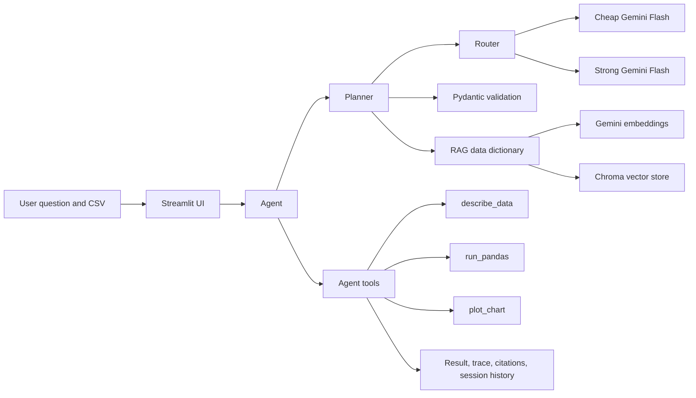

# Data Analyst Copilot

Data Analyst Copilot is a Streamlit application that turns English questions about a sales CSV into validated pandas analysis plans, executes the plans safely, and displays tables, charts, citations, and tool traces.

## Setup

```powershell
python -m venv .venv
.\.venv\Scripts\Activate.ps1
.\.venv\Scripts\python -m pip install -r requirements.txt
```

Create `.env` in the repository root:

```env
GEMINI_API_KEY=your_api_key
CHEAP_MODEL=gemini-3.7-flash
STRONG_MODEL=gemini-3.8-flash
```

## Run

```powershell
.\.venv\Scripts\streamlit run app.py
```

Open `http://localhost:8501`, upload a compatible CSV if needed, and ask an English question.

For Streamlit Community Cloud, add these values under App settings > Secrets:

```toml
GEMINI_API_KEY = "your_api_key"
CHEAP_MODEL = "gemini-3.7-flash"
STRONG_MODEL = "gemini-3.8-flash"
EMBED_MODEL = "gemini-embedding-001"
```

## Architecture



## Branch architecture

- `v1-llm`: two-model Gemini client, routing, retries, and cost records.
- `v2-prompting`: Pydantic analysis plans, structured prompts, and validation retries.
- `v3-rag`: Chroma retrieval over the data dictionary with citations.
- `v4-agent`: pandas execution tools, charts, traces, session state, and Streamlit UI.

## Tests

```powershell
.\.venv\Scripts\python -m pytest tests -v
```

The test suite has 15 passing unit tests.

## Evaluation

The evaluation contains 11 English reference-answer questions. The recorded run reached 8 questions before Gemini free-tier quota exhaustion and all 8 reached questions were correct. One earlier request also failed with a 504 timeout.

| Metric | Recorded result |
| --- | ---: |
| Questions | 11 |
| Questions reaching the model | 8 |
| Correct answers among questions reaching the model | 8/8 |
| Overall recorded correctness | 72.7% |
| First-try code success | 53.3% |
| Code success after auto-fix | 53.3% |

## Limitations

- Gemini free-tier quota is limited to 20 requests per day per model and can prevent a full evaluation or live demo.
- The sales data is synthetic.
- `prices.json` contains configured standard Flash price estimates, but actual billing and account-specific pricing are not validated.
