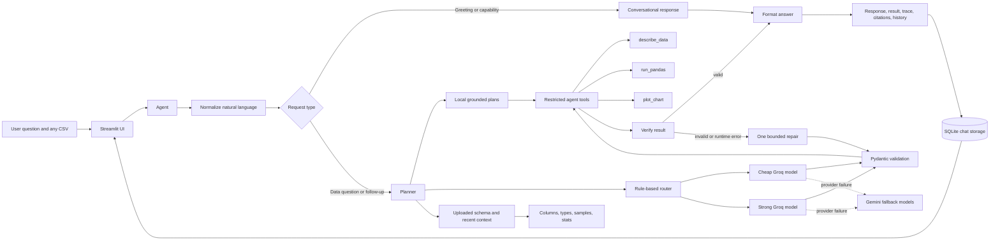

# Data Analyst Copilot

Data Analyst Copilot is a Streamlit application that turns English questions about any uploaded CSV into validated pandas analysis plans, executes the plans safely, and displays tables, charts, citations, and tool traces. It profiles each uploaded dataframe so the hosted agent can work with new schemas and general analysis questions. It uses local deterministic handling for basic questions, Groq as the hosted planning provider, Gemini as a provider fallback, restricted pandas tools for execution, and SQLite persistence for chat sessions.

## Setup

```powershell
python -m venv .venv
.\.venv\Scripts\Activate.ps1
.\.venv\Scripts\python -m pip install -r requirements.txt
```

Create `.env` in the repository root:

```env
GEMINI_API_KEY=your_api_key
CHEAP_MODEL=gemini-3.7-flash
STRONG_MODEL=gemini-3.8-flash
GROQ_API_KEY=your_groq_api_key
GROQ_CHEAP_MODEL=openai/gpt-oss-20b
GROQ_STRONG_MODEL=openai/gpt-oss-120b
```

## Run

```powershell
.\.venv\Scripts\streamlit run app.py
```

Open `http://localhost:8501`, upload a CSV, and ask an English question about its contents.

## How to use

1. Start the Streamlit app with the command above.
2. Keep the included `data/sales.csv`, or upload another CSV from the sidebar.
3. Type a normal English question in the chat box.
4. Watch the status message while the agent profiles the uploaded data, creates a plan, and runs the pandas code.
5. Review the goal, steps, generated code, result table, and chart.
6. Expand **What the agent did** to inspect the tool trace and **Analysis details** to see token usage, cost estimate, and citations.
7. Return to the app later with the same dataset source to reload saved chats from SQLite.

Example questions:

```text
What are the top 5 products by revenue?
Can you find the top 5 product?
What is the total revenue?
How many orders were placed in Cairo?
What is the average discount across all orders?
Show revenue by region
Show monthly revenue
What is the average revenue by region?
How many orders per category?
Which product sold the most units?
```

The agent profiles every uploaded CSV and sends its actual columns, types, sample values, cardinalities, and numeric ranges to the planner. New or complex questions are sent to Groq first, then Gemini if Groq fails. The local fallback handles basic schema questions and common sales examples without using a hosted API. If both providers are unavailable and the fallback cannot recognize the question, the app displays a clear limitation instead of inventing an answer.

For Streamlit Community Cloud, add these values under App settings > Secrets:

```toml
GEMINI_API_KEY = "your_api_key"
CHEAP_MODEL = "gemini-3.7-flash"
STRONG_MODEL = "gemini-3.8-flash"
GROQ_API_KEY = "your_groq_api_key"
GROQ_CHEAP_MODEL = "openai/gpt-oss-20b"
GROQ_STRONG_MODEL = "openai/gpt-oss-120b"
EMBED_MODEL = "gemini-embedding-001"
```

## Architecture



### Request flow

1. Streamlit creates a session for the uploaded dataset.
2. The agent profiles the data with `describe_data` and builds uploaded-schema context.
3. The request is normalized so harmless wording, punctuation, and common polite phrasing do not change its meaning.
4. Greetings and capability questions return conversational responses without pretending that analysis was performed.
5. Data questions and follow-ups use recent context plus the live schema profile.
6. The planner checks local grounded handlers first for supported operations.
7. Remaining questions go to the router, which selects the cheap or strong Groq model.
8. If Groq fails, the router retries with the corresponding Gemini model.
9. The planner returns a structured `AnalysisPlan` with explicit intent fields, validated by Pydantic.
10. `run_pandas` executes only validated code against a copy of the dataframe.
11. The verifier checks the result shape and requested comparisons; execution or verification failures get one bounded repair attempt.
12. `plot_chart` creates a chart when the plan requests one.
13. The UI displays the answer, code, result, chart, citations, and tool trace without provider internals.
14. Chat records are saved to SQLite and reloaded for the selected dataset source.

The hosted planner is data-agnostic within the uploaded CSV: it can use new column names and new analysis questions because the current dataframe profile is included in the planning context. Its role, goal, tools, and plan→execute→verify workflow are defined in the system instructions. The optional RAG dictionary is not required for uploaded-data planning.

The local layer is intentionally conservative. It normalizes common conversational variations and handles basic schema questions and selected grounded examples without an API, while hosted models provide general open-ended analysis. A ranking request such as "top 5 products" defaults to revenue when a revenue column exists; specify another metric such as quantity when needed. Unsupported questions produce an explicit limitation instead of a fabricated answer. A generic execution failure produces a separate neutral error message, and neither message exposes provider, model, quota, key, or raw exception details.

### Session persistence

Chat titles, user messages, assistant messages, generated plans, result tables, code, traces, and analysis history are stored in SQLite. The database path defaults to `data/analyst.db` and can be changed with `DATABASE_PATH`. The default path is ignored by Git.

SQLite is suitable for this single-user or small demonstration deployment. Streamlit Cloud storage is not guaranteed to survive a container replacement, and the current app does not provide user authentication. For a multi-user production deployment, replace this storage adapter with authenticated Supabase/PostgreSQL storage and scope chats to a user ID.

## Branch architecture

- `v1-llm`: two-model Gemini client, routing, retries, and cost records.
- `v2-prompting`: Pydantic analysis plans, structured prompts, and validation retries.
- `v3-rag`: Chroma retrieval over the data dictionary with citations.
- `v4-agent`: pandas execution tools, charts, traces, session state, and Streamlit UI.

## Technical decisions

- Use two Groq models with rule-based routing so simple questions use the cheaper tier and complex questions use the stronger tier, with Gemini as a provider fallback.
- Use Pydantic validation for structured analysis plans before executing generated pandas code.
- Verify result shape and requested comparisons after execution, with one bounded repair attempt.
- Preserve recent questions and result columns as context for follow-up questions.
- Define the analyst role, goal, tools, workflow, and failure behavior explicitly instead of relying on a framework-specific persona.
- Profile every uploaded dataframe and provide its live schema, samples, and numeric statistics to the planner.
- Keep Chroma and embeddings optional; uploaded-data profiling is the primary planning context and does not require a startup embedding call.
- Execute generated code only through restricted pandas tools that block imports, file access, and other unsafe operations.
- Keep the evaluation honest by recording quota and timeout failures instead of treating them as correct answers.
- Use a small deterministic local layer for basic schema questions and selected examples; unsupported open-ended questions remain explicit failures without hosted providers.
- Normalize natural-language variants before planning, while keeping conversational responses separate from dataframe results.
- Persist chat sessions through a small SQLite adapter, with a documented path to authenticated hosted storage for production multi-user use.

## Validation

The historical 35-test suite is not included in the deployed repository. Current validation uses Python compilation, direct agent smoke tests, custom uploaded-data checks, Streamlit startup checks, and the evaluation below.

## Evaluation

The evaluation contains 11 English reference-answer questions. The latest clean run completed all 11 questions using the configured provider chain and deterministic fallback support.

| Metric | Latest recorded result |
| --- | ---: |
| Questions | 11 |
| Correct answers | 11/11 |
| Overall correctness | 100.0% |
| First-try code success | 100.0% |
| Code success after auto-fix | 100.0% |
| Average time per question | 0.07 seconds |

Run it from the repository root with:

```powershell
.\.venv\Scripts\python -m evaluation.run_eval
```

The recorded rows identify the provider used for each question. The benchmark measures the included dataset and does not prove unlimited open-ended model capability.

## Limitations

- Gemini free-tier quota is limited to 20 requests per day per model and can prevent a full evaluation or live demo.
- Groq is the primary hosted provider for deployment availability, while Gemini remains configured as a second provider and fallback. The local fallback does not replace the hosted LLM layer.
- The local layer is not an unlimited language model. Open-ended questions on arbitrary datasets need a configured hosted provider. Production deployments should add rate limiting, caching, and a higher-quota or secondary model provider for many users.
- The sales data is synthetic.
- `prices.json` contains configured standard Flash price estimates, but actual billing and account-specific pricing are not validated.
