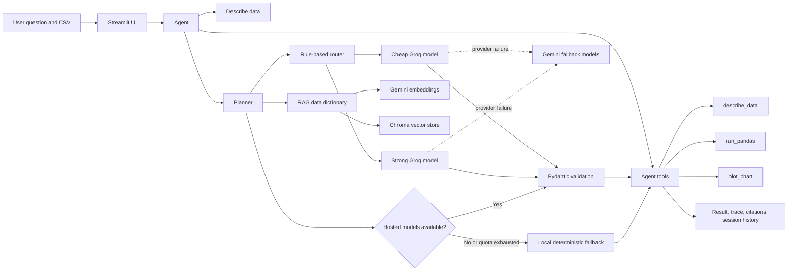

# Data Analyst Copilot

Data Analyst Copilot is a Streamlit application that turns English questions about a sales CSV into validated pandas analysis plans, executes the plans safely, and displays tables, charts, citations, and tool traces. It uses Groq as the hosted planning provider, Gemini as a provider fallback, and a deterministic local fallback for common sales questions.

## Setup

```powershell
python -m venv .venv
.\.venv\Scripts\Activate.ps1
.\.venv\Scripts\python -m pip install -r requirements.txt
```

Create `.env` in the repository root:

```env
GEMINI_API_KEY=your_api_key
CHEAP_MODEL=gemini-3.7-flash
STRONG_MODEL=gemini-3.8-flash
GROQ_API_KEY=your_groq_api_key
GROQ_CHEAP_MODEL=openai/gpt-oss-20b
GROQ_STRONG_MODEL=openai/gpt-oss-120b
```

## Run

```powershell
.\.venv\Scripts\streamlit run app.py
```

Open `http://localhost:8501`, upload a compatible CSV if needed, and ask an English question.

## How to use

1. Start the Streamlit app with the command above.
2. Keep the included `data/sales.csv`, or upload another CSV from the sidebar.
3. Type a normal English question in the chat box.
4. Watch the status message while the agent describes the data, creates a plan, and runs the pandas code.
5. Review the goal, steps, generated code, result table, and chart.
6. Expand **What the agent did** to inspect the tool trace and **Analysis details** to see the model, tier, token usage, cost estimate, and citations.

Example questions:

```text
What are the top 5 products by revenue?
What is the total revenue?
How many orders were placed in Cairo?
What is the average discount across all orders?
Show revenue by region
Show monthly revenue
What is the average revenue by region?
How many orders per category?
Which product sold the most units?
```

The local fallback handles the common sales patterns listed above without using a hosted API. New or more complex questions are sent to Groq first, then Gemini if Groq fails. If both providers are unavailable and the fallback cannot recognize the question, the app displays a clear limitation instead of inventing an answer.

For Streamlit Community Cloud, add these values under App settings > Secrets:

```toml
GEMINI_API_KEY = "your_api_key"
CHEAP_MODEL = "gemini-3.7-flash"
STRONG_MODEL = "gemini-3.8-flash"
GROQ_API_KEY = "your_groq_api_key"
GROQ_CHEAP_MODEL = "openai/gpt-oss-20b"
GROQ_STRONG_MODEL = "openai/gpt-oss-120b"
EMBED_MODEL = "gemini-embedding-001"
```

## Architecture



### Request flow

1. Streamlit creates a session for the uploaded dataset.
2. The agent profiles the data with `describe_data`.
3. RAG retrieves relevant data-dictionary entries and citations when semantic search is available.
4. The router sends the question to the cheap or strong Groq model based on complexity.
5. The planner returns a structured `AnalysisPlan`, validated by Pydantic.
6. If Groq fails, the router retries the request with the corresponding Gemini model.
7. If both hosted providers fail, the local fallback creates a plan for supported sales patterns.
8. `run_pandas` executes only validated code against a copy of the dataframe.
9. `plot_chart` creates a chart when the plan requests one.
10. The UI displays the answer, code, result, chart, citations, and tool trace.

The fallback is intentionally conservative. It computes only recognized operations and does not pretend to answer unsupported questions.

## Branch architecture

- `v1-llm`: two-model Gemini client, routing, retries, and cost records.
- `v2-prompting`: Pydantic analysis plans, structured prompts, and validation retries.
- `v3-rag`: Chroma retrieval over the data dictionary with citations.
- `v4-agent`: pandas execution tools, charts, traces, session state, and Streamlit UI.

## Technical decisions

- Use two Groq models with rule-based routing so simple questions use the cheaper tier and complex questions use the stronger tier, with Gemini as a provider fallback.
- Use Pydantic validation for structured analysis plans before executing generated pandas code.
- Use Chroma and Gemini embeddings for data-dictionary retrieval, with citations and a local dictionary fallback when embeddings are unavailable.
- Execute generated code only through restricted pandas tools that block imports, file access, and other unsafe operations.
- Keep the evaluation honest by recording quota and timeout failures instead of treating them as correct answers.
- Use a deterministic local fallback for common sales questions when Gemini quota is exhausted; unsupported questions remain explicit failures.

## Tests

```powershell
.\.venv\Scripts\python -m pytest tests -v
```

The test suite has 19 passing unit tests.

## Evaluation

The evaluation contains 11 English reference-answer questions. The recorded run reached 8 questions before Gemini free-tier quota exhaustion and all 8 reached questions were correct. One earlier request also failed with a 504 timeout.

| Metric | Recorded result |
| --- | ---: |
| Questions | 11 |
| Questions reaching the model | 8 |
| Correct answers among questions reaching the model | 8/8 |
| Overall recorded correctness | 72.7% |
| First-try code success | 53.3% |
| Code success after auto-fix | 53.3% |

## Limitations

- Gemini free-tier quota is limited to 20 requests per day per model and can prevent a full evaluation or live demo.
- Groq is the primary hosted provider for deployment availability, while Gemini remains configured as a second provider and fallback. The local fallback does not replace the hosted LLM layer.
- The fallback is designed for common sales analysis, not unlimited natural-language understanding. Production deployments should add rate limiting, caching, and a higher-quota or secondary model provider for many users.
- The sales data is synthetic.
- `prices.json` contains configured standard Flash price estimates, but actual billing and account-specific pricing are not validated.
